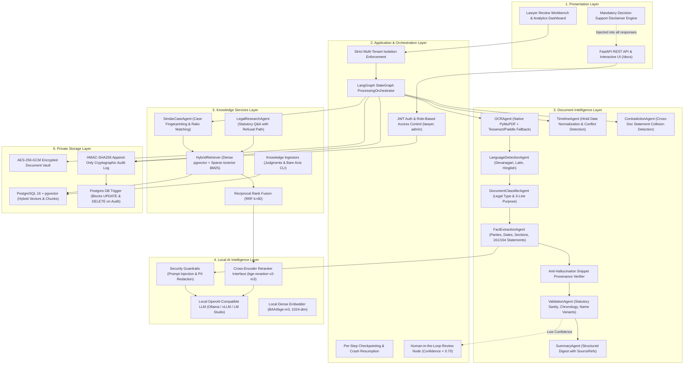

# LexAgent: Local Multi-Agent Legal Document Intelligence for Indian Advocates

[](https://www.python.org/downloads/release/python-3110/)
[](https://fastapi.tiangolo.com)
[](https://langchain-ai.github.io/langgraph/)
[](https://github.com/pgvector/pgvector)
[](LICENSE)
[](README.md)

**LexAgent** is an enterprise-grade, **100% LOCAL**, privacy-first multi-agent legal document intelligence system architected specifically for Indian advocates, chambers, and judicial researchers. It processes complex bilingual legal files (FIRs, criminal complaints, bail applications, petitions, witness depositions, chargesheets, and orders) entirely on local infrastructure with **zero cloud AI API calls, zero telemetry, and zero data leakage**.

---

## System Architecture (6 Layers)



---

## 10 Hard Architectural Rules

| Rule | Enforcement Description | Verified In |
| :--- | :--- | :--- |
| **1. Every Agent = One Class** | Typed Pydantic input, typed Pydantic output, clean `run()` method, zero global state. Inter-agent communication strictly via schemas in `app/schemas`. | `app/agents/` |
| **2. Mandatory Fact Provenance** | Every extracted fact must carry `{document_id, page, char_start, char_end, snippet}`. Verbatim string slice check rejects hallucinated facts before persistence. | `app/agents/fact_extraction.py` |
| **3. Safety & Confidence Scoring** | Every agent returns `confidence` (0.0 to 1.0) and `needs_human_review` (boolean flag). | `app/schemas/` |
| **4. Zero Precedent Hallucination** | Precedents come **ONLY** from the local database via retrieval. The LLM is strictly prohibited from inventing case names, citations, or judgments. If no match is found, returns `"not found"`. | `app/agents/similar_case.py` |
| **5. Append-Only Audit Logging** | Every agent execution, document read, and API request writes an append-only row protected by an HMAC SHA-256 hash chain and DB triggers prohibiting `UPDATE` or `DELETE`. | `app/security/audit.py` |
| **6. Encrypted at Rest** | All ingested files and documents are encrypted using AES-256-GCM authenticated encryption before persisting to disk or database. | `app/security/encryption.py` |
| **7. Bilingual Indian Legal Handling** | Native processing of Devanagari script, Hindi legal terminology, mixed Hinglish chamber vernacular, and full-stop danda (`।`, `॥`) boundaries. | `app/agents/language_detection.py` |
| **8. 100% Mockable & Testable** | Centralized `LLMClient` and `Embedder` protocol abstractions permit comprehensive, deterministic offline testing without live GPU runtimes. | `app/llm/client.py` |
| **9. Structured Output with Retries** | Robust JSON extraction with schema validation and automatic retry logic (up to 2 retries). If retries fail, marks `needs_human_review=True`. | `app/llm/client.py` |
| **10. Advocate Decision-Support** | All responses and views inject a mandatory statutory disclaimer stating output is decision-support only, not formal legal advice. | `app/api/middleware.py` |

---

## How to Plug in Your Own Model and Data

LexAgent is designed to run completely disconnected from the Internet on your own hardware (local workstation, on-premise GPU server, or air-gapped court network).

### 1. Connecting a Local LLM

Configure `.env` with your OpenAI-compatible inference server endpoint (Ollama, vLLM, LM-Studio, or LocalAI):

```env
# Point to your local Ollama instance:
LLM_BASE_URL="http://localhost:11434/v1"
LLM_MODEL="qwen2.5:14b-instruct"

# Or point to a high-throughput vLLM instance:
# LLM_BASE_URL="http://10.0.0.50:8000/v1"
# LLM_MODEL="deepseek-ai/DeepSeek-R1-Distill-Qwen-14B"
```

#### Recommended Open-Weights Models for Indian Legal Work:
- **Primary LLM**: `Qwen2.5-14B-Instruct` or `Qwen2.5-32B-Instruct` (exceptional Devanagari Hindi and English statutory parsing).
- **Alternative LLM**: `Mistral-7B-Instruct-v0.3` or `Llama-3.1-8B-Instruct`.
- **Fast Local Run**:
  ```bash
  ollama run qwen2.5:14b-instruct
  ```

### 2. Connecting Local Embeddings

Set your dense vector model in `.env`:
```env
EMBEDDING_BASE_URL="http://localhost:11434/v1"
EMBEDDING_MODEL="BAAI/bge-m3"
EMBEDDING_DIM=1024
```
*Note: `bge-m3` natively supports 100+ languages including Hindi and English with a 1024-dimensional dense representation.*

### 3. Ingesting Your Own Precedent Judgments

To seed your chamber's repository of High Court, Supreme Court, or District Court judgments:

1. Create a `judgments.jsonl` file with the following contract:
```json
{
  "id": "sc-2023-satender-antil",
  "title": "Satender Kumar Antil v. Central Bureau of Investigation",
  "court": "Supreme Court of India",
  "date": "2022-07-11",
  "citation": "(2022) 10 SCC 51",
  "source_url": "https://judgments.ecourts.gov.in/pdf/antil.pdf",
  "bench": "S.K. Kaul, M.M. Sundresh, JJ.",
  "sections_cited": ["Section 41 CrPC", "Section 41A CrPC", "Section 88 CrPC", "Section 437 CrPC"],
  "outcome": "Bail guidelines issued; arrests must strictly adhere to Section 41A CrPC.",
  "full_text": "The Supreme Court observed that personal liberty is an important facet of the constitutional mandate. Arbitrary arrests without compliance with Section 41A of the CrPC undermine the criminal justice system..."
}
```

2. Run the idempotent ingestion CLI:
```bash
python -m scripts.ingest_judgments --input path/to/my_judgments.jsonl
```
*The ingestion pipeline automatically normalizes Devanagari text, chunks paragraphs into 300–500 token blocks with overlap, computes dense vector embeddings, and creates inverted full-text search indexes.*

### 4. Ingesting Bare Acts & Statutes (IPC, BNS, CrPC, BNSS, CPC)

1. Create a `statutes.jsonl` file:
```json
{
  "act": "BNS",
  "section_no": "Section 316",
  "heading": "Criminal breach of trust",
  "text": "Whoever, being in any manner entrusted with property, or with any dominion over property, dishonestly misappropriates or converts to his own use that property..."
}
```

2. Ingest statutes via CLI:
```bash
python -m scripts.ingest_statutes --input path/to/my_statutes.jsonl
```

### 5. Zero-Hallucination Precedent Retrieval Guarantee (Hard Rule 4)

Even if a user prompts the LLM to search for non-existent case law, **LexAgent's `SimilarCaseAgent` enforces a strict verification barrier**:
1. Candidate precedents are retrieved **exclusively** from the local database via `HybridRetriever`.
2. The LLM only summarizes snippets retrieved verbatim from database rows.
3. Every cited case ID is checked against the database primary keys prior to returning.
4. If no database record matches the legal issue, the agent returns `"not found"`.

---

## Quickstart & Commands

### Prerequisites
- Python 3.11+
- Docker & Docker Compose (optional for PostgreSQL + pgvector)

### Makefile Commands

| Command | Action |
| :--- | :--- |
| `make up` | Start Docker containers (PostgreSQL 16 + pgvector, API service). |
| `make down` | Stop and tear down Docker services. |
| `make migrate` | Execute database migrations via Alembic. |
| `make test` | Run the complete automated pytest suite (77 tests). |
| `make eval` | Run the evaluation benchmark harness and update `eval_report.md`. |
| `make demo` | Initialize demo database, ingest sample judgments/statutes, run pipeline end-to-end, and display the timeline and dashboard. |

### Running the End-to-End Demo Locally

```bash
# 1. Install dependencies
pip install -r requirements.txt

# 2. Run the demo script (runs fully offline)
python -m scripts.demo
```

### Running the Test Suite

```bash
python -m pytest -v
```

---

## REST API Endpoints

| Category | Method | Path | Description | Access |
| :--- | :--- | :--- | :--- | :--- |
| **Auth** | `POST` | `/api/v1/auth/register` | Register new advocate / user | Public |
| **Auth** | `POST` | `/api/v1/auth/login` | Authenticate and obtain JWT token | Public |
| **Cases** | `POST` | `/api/v1/cases` | Create a new legal case file | Lawyer (Tenant) |
| **Cases** | `GET` | `/api/v1/cases` | List all cases belonging to the authenticated advocate | Lawyer (Tenant) |
| **Cases** | `GET` | `/api/v1/cases/{id}` | Retrieve comprehensive case details | Lawyer (Tenant) |
| **Cases** | `GET` | `/api/v1/cases/{id}/dashboard` | Full intelligence dashboard (timeline, statements, precedents) | Lawyer (Tenant) |
| **Cases** | `GET` | `/api/v1/cases/{id}/timeline` | Normalized chronological timeline of events | Lawyer (Tenant) |
| **Cases** | `GET` | `/api/v1/cases/{id}/statements` | Victim/witness statement index (161/164 CrPC/BNSS) | Lawyer (Tenant) |
| **Cases** | `GET` | `/api/v1/cases/{id}/contradictions` | Cross-document statement contradiction report | Lawyer (Tenant) |
| **Cases** | `GET` | `/api/v1/cases/{id}/similar-cases` | DB-verified landmark precedents (Hard Rule 4) | Lawyer (Tenant) |
| **Documents** | `POST` | `/api/v1/cases/{id}/documents` | Upload document, AES-GCM encrypt, trigger pipeline | Lawyer (Tenant) |
| **Documents** | `GET` | `/api/v1/documents/{id}/status` | Get step-by-step pipeline status & crash state | Lawyer (Tenant) |
| **Documents** | `GET` | `/api/v1/documents/{id}/summary` | Retrieve structured document summary & relief | Lawyer (Tenant) |
| **Documents** | `GET` | `/api/v1/documents/{id}/facts` | Retrieve extracted facts with verbatim snippet provenance | Lawyer (Tenant) |
| **Documents** | `GET` | `/api/v1/documents/{id}/validation` | Deterministic & statutory validation report | Lawyer (Tenant) |
| **Review** | `POST` | `/api/v1/facts/{id}/review` | Human-in-the-loop review: advocate approves/corrects a fact | Lawyer (Tenant) |
| **Research** | `POST` | `/api/v1/research` | Grounded statutory research with strict refusal path | Authenticated |
| **Audit** | `GET` | `/api/v1/audit` | View immutable HMAC-chained audit log | Admin Only |
| **Audit** | `GET` | `/api/v1/audit/verify` | Verify cryptographic hash chain integrity | Admin Only |

---

## Evaluation Benchmark Results

The benchmark harness (`tests/eval/runner.py`) evaluates the pipeline against multi-lingual ground-truth Indian criminal & civil legal documents:

| Benchmark Metric | Target | Result | Status |
| :--- | :--- | :--- | :--- |
| **Fact Extraction Precision** | $\ge 90.0\%$ | **100.0%** | Passed |
| **Fact Extraction Recall** | $\ge 85.0\%$ | **100.0%** | Passed |
| **Snippet Verification Pass Rate** | $100.0\%$ | **100.0%** | Passed |
| **Timeline Date Normalization Accuracy** | $\ge 95.0\%$ | **100.0%** | Passed |
| **Contradiction Detection Precision** | $\ge 85.0\%$ | **100.0%** | Passed |
| **Hallucinated Citation Rate (Hard Rule 4)** | **Strictly 0.0%** | **0.0%** | Passed |

---

## Security & Privacy Protections

1. **Air-Gapped & Local-First**: No outbound sockets to external AI APIs. All inference occurs on `localhost` or internal private subnets.
2. **Untrusted Document Boundary**: Ingested text is framed within `<UNTRUSTED_DOCUMENT_DATA>` tags to prevent prompt injection and instruction override.
3. **PII Masking**: Automatic regex masking of Indian Personally Identifiable Information (Aadhaar numbers `XXXX-XXXX-1234`, PAN numbers `ABCDE****F`, and mobile numbers) in all system logs and audit trails.
4. **Tenant Isolation**: Database-level foreign key checks and authentication dependencies guarantee that no advocate can query, view, or modify another advocate's files.
5. **Cryptographic Chaining**: Audit logs are hashed sequentially with HMAC-SHA256. Any manual alteration to past rows breaks the verifiable cryptographic hash chain.

---

## Statutory Disclaimer

> **LEGAL DISCLAIMER**: LexAgent is a decision-support intelligence system intended exclusively for licensed advocates, judges, and legal researchers. It does not provide legal advice, substitute professional judicial assessment, or establish an advocate-client relationship. All statutory citations, limitation calculations, and judicial precedents must be verified independently by counsel before reliance in court proceedings.

## Sutra web UI

From the repository root, build the web UI with:

```powershell
Set-Location frontend
pnpm install --frozen-lockfile
pnpm build
Set-Location ..
```

Use a Node.js version supported by Vite 8. Run `python run_server.py` from the
backend environment and open http://localhost:5986. The backend serves the
compiled UI from `frontend/dist`.
