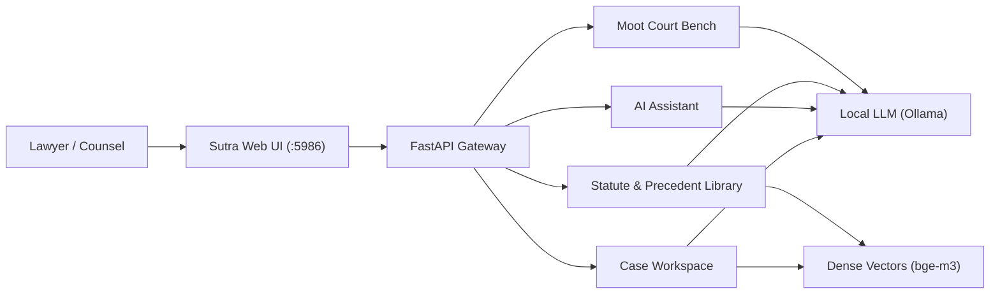

# 🏛️ Sutra Legal Intelligence & LexAgent — Complete Setup & Architecture Guide

> **100% Local, Privacy-First Multi-Agent Legal Workspace for Indian Advocates, Judicial Researchers, and Law Chambers.**  
> *Zero cloud API dependencies · Zero telemetry · Zero data leakage · Works entirely offline.*

---

## 📋 Table of Contents
1. [Overview](#-overview)
2. [System Requirements](#-system-requirements)
3. [Local LLM & Embedding Setup (Ollama)](#-local-llm--embedding-setup-ollama)
   - [Step 1: Install Ollama](#step-1-install-ollama)
   - [Step 2: Models to Download & Why](#step-2-models-to-download--why)
   - [Step 3: Verification & CLI Testing](#step-3-verification--cli-testing)
4. [Environment Configuration (`.env`)](#-environment-configuration-env)
5. [Backend Installation (Python FastAPI)](#-backend-installation-python-fastapi)
6. [Frontend UI Installation (React + Tailwind CSS)](#-frontend-ui-installation-react--tailwind-css)
7. [Running the Entire System (How to Run)](#-running-the-entire-system-how-to-run)
   - [Option A: One-Command Unified Launcher (Recommended)](#option-a-one-command-unified-launcher-recommended)
   - [Option B: Development Mode (Separate Terminals)](#option-b-development-mode-separate-terminals)
8. [Core Modules & Usage](#-core-modules--usage)
9. [Troubleshooting & FAQs](#-troubleshooting--faqs)

---

## 🌟 Overview

**Sutra** is a modern, privacy-first legal workbench designed specifically for the Indian legal ecosystem. Powered by **LexAgent**, a 16-agent cooperative architecture, Sutra performs:
- **Case Ingestion & OCR:** Extracts facts, dates, witness statements (§161/164 CrPC), and statutory references from FIRs, petitions, plaints, and trial orders.
- **Statutory & Precedent Research:** Connects to local Bare Acts (IPC/BNS, CrPC/BNSS, Evidence Act/BSA) and landmark Supreme Court & High Court judgments.
- **Moot Court Simulation:** AI-driven judge bench conducting simulated courtroom hearings, testing submissions with counter-questions, dynamically shifting leaning scores, and issuing structured verdict orders and coaching feedback.
- **Bilingual Legal Translation & AI Assistant:** Real-time English <-> Hindi translation with terminology protection and conversational case Q&A.

---

## 💻 System Requirements

| Component | Minimum Specification | Recommended Specification |
| :--- | :--- | :--- |
| **Operating System** | Windows 10/11 (64-bit), Ubuntu 22.04+, macOS 13+ | Windows 11 or Linux |
| **Processor (CPU)** | Intel Core i5 / AMD Ryzen 5 (6+ cores) | Intel Core i7 / i9 / Ryzen 7 (8+ cores) |
| **RAM** | 16 GB DDR4/DDR5 | 32 GB DDR5 |
| **Dedicated GPU** | None (CPU mode supported) | NVIDIA RTX 3060, 4060, or **RTX 4070 (12 GB VRAM)** |
| **Disk Space** | 20 GB free SSD storage | 50 GB NVMe SSD |
| **Software** | Python 3.11+, Node.js 18+ (with `pnpm`), Git | Python 3.11, Node.js 20, pnpm 9, Ollama |

---

## 🦙 Local LLM & Embedding Setup (Ollama)

LexAgent connects to local AI models using **Ollama** via an OpenAI-compatible HTTP interface (`http://localhost:11434/v1`).

### Step 1: Install Ollama

1. **Download Ollama:**
   - **Windows:** Download the installer from [https://ollama.com/download/windows](https://ollama.com/download/windows) and run `OllamaSetup.exe`.
   - **Linux:** Run in terminal:
     ```bash
     curl -fsSL https://ollama.com/install.sh | sh
     ```
   - **macOS:** Download the `.zip` installer from [https://ollama.com/download/mac](https://ollama.com/download/mac).

2. **Verify Ollama is Running:**
   Open PowerShell or Terminal and run:
   ```bash
   ollama --version
   ```
   *Expected output: `ollama version is 0.5.x` or newer.*  
   The Ollama background daemon runs automatically and listens on port `11434`.

---

### Step 2: Models to Download & Why

You need **two local models**:
1. **Chat & Reasoning Model (LLM):** For Judge agent counter-questions, draft verdict generation, case summarization, and AI legal assistant.
2. **Dense Multilingual Embedding Model:** For vector search, semantic fact retrieval, and landmark precedent matching.

#### Model 1: Chat / Reasoning Model
- **Recommended Default:** `qwen2.5:7b-instruct` (~4.7 GB)
  - **Why:** Ultra-fast latency (<2s on RTX 4070 / ~8s on CPU), excellent understanding of Indian legal terminology, bilingual English/Hindi support, and low VRAM footprint (~5.5 GB).
  - Command:
    ```bash
    ollama pull qwen2.5:7b-instruct
    ```
- **High-Capacity / Chamber Server Model:** `qwen2.5:14b-instruct` (~9.0 GB)
  - **Why:** Deep statutory reasoning and complex judicial draft generation. Requires a GPU with 12 GB VRAM (like an RTX 4070).
  - Command:
    ```bash
    ollama pull qwen2.5:14b-instruct
    ```

#### Model 2: Dense Embedding Model
- **Model:** `bge-m3:latest` (~1.2 GB)
  - **Why:** State-of-the-art multilingual embedding model from BAAI supporting 1024-dimension dense vectors. Essential for cross-lingual English-Hindi case matching.
  - Command:
    ```bash
    ollama pull bge-m3:latest
    ```

---

### Step 3: Verification & CLI Testing

Run `ollama list` to verify both models are downloaded:
```bash
ollama list
```
*Expected Output:*
```text
NAME                     ID              SIZE      MODIFIED
bge-m3:latest            790764642607    1.2 GB    ...
qwen2.5:7b-instruct      2bada8a74506    4.7 GB    ...
```

Test direct completion via CLI:
```bash
ollama run qwen2.5:7b-instruct "What are the essential ingredients of Section 420 IPC?"
```
*When Ollama replies, type `/bye` to exit.*

---

## ⚙️ Environment Configuration (`.env`)

In the project root or `final/lexagent/lexagent/.env`, ensure the following configuration exists:

```ini
# ==============================================================================
# SUTRA & LEXAGENT ENVIRONMENT CONFIGURATION
# ==============================================================================

# Local LLM Runtime (Ollama / vLLM / LM Studio)
LLM_BASE_URL=http://localhost:11434/v1
LLM_MODEL=qwen2.5:7b-instruct
LLM_TEMPERATURE=0.1
LLM_MAX_RETRIES=2

# Local Embedding Model
EMBEDDING_BASE_URL=http://localhost:11434/v1
EMBEDDING_MODEL=bge-m3:latest

# Moot Court Engine Settings
MOOT_DRAFT_TIMEOUT=30
MOOT_DRAFT_RETRIES=1
MOOT_DRAFT_MAX_TOKENS=1600

# Database Configuration (SQLite default; PostgreSQL + pgvector optional)
DATABASE_URL=sqlite:///lexagent.db
DB_URL=sqlite:///lexagent.db
AUTO_INIT_DB=true

# Security & Authentication
JWT_SECRET=sutra-local-advocate-secret-key-2026-secure
DEMO_MODE=false
```

> [!NOTE]
> **Graceful Fallback Honesty:**  
> If Ollama is temporarily stopped or a model is being pulled, the server will **not crash**. LexAgent automatically uses deterministic legal rules and tags responses with `template_fallback_used: true` and the exact cause (e.g., `connection_refused`, `model_not_found`, `timeout`).

---

## 🐍 Backend Installation (Python FastAPI)

1. **Open PowerShell / Terminal in the repository root:**
   ```powershell
   cd c:\Users\PC\Downloads\final
   ```

2. **Create and Activate Python Virtual Environment:**
   ```powershell
   # Create virtual environment
   python -m venv final\lexagent\venv

   # Activate virtual environment (Windows PowerShell)
   .\final\lexagent\venv\Scripts\Activate.ps1
   ```

3. **Install Backend Dependencies:**
   ```powershell
   pip install --upgrade pip
   pip install -r final\lexagent\lexagent\requirements.txt
   ```

4. **Verify Backend Tests:**
   ```powershell
   python -m pytest final\lexagent\lexagent\tests\test_moot_court.py final\lexagent\lexagent\tests\test_moot_draft.py final\lexagent\lexagent\tests\test_moot_report.py -q
   ```
   *Expected: `25 passed`.*

---

## 🎨 Frontend UI Installation (React + Tailwind CSS)

1. **Install `pnpm` (if not already installed):**
   ```powershell
   npm install -g pnpm
   ```

2. **Navigate to the UI directory:**
   ```powershell
   cd "final/SUTRA da UIUX"
   ```

3. **Install Dependencies:**
   ```powershell
   pnpm install
   ```

4. **Build the Production Web UI:**
   ```powershell
   pnpm run build
   ```
   *This compiles optimized assets into `final/SUTRA da UIUX/dist` which `start_server.py` hosts.*

---

## 🚀 Running the Entire System (How to Run)

### Option A: One-Command Unified Launcher (Recommended)

From the project root directory (`c:\Users\PC\Downloads\final`):

```powershell
python start_server.py --port 5986
```

**What this command does automatically:**
1. Verifies the SQLite database (`lexagent.db`) and seeds Bare Acts and landmark precedents if first run.
2. Runs the startup LLM health check, verifying connection to Ollama and logging model status.
3. Hosts the FastAPI backend REST API at `http://localhost:5986/api/v1`.
4. Hosts the compiled interactive Sutra Web UI at `http://localhost:5986`.
5. Launches your default web browser directly to the dashboard!

---

### Option B: Development Mode (Separate Terminals)

If you are developing UI or backend code with hot-reloading:

#### Terminal 1: Local LLM Service
```powershell
ollama serve
```

#### Terminal 2: Backend API
```powershell
cd final\lexagent\lexagent
..\..\venv\Scripts\activate
uvicorn app.api.main:app --host 127.0.0.1 --port 5988 --reload
```
- API Docs: `http://127.0.0.1:5988/docs`

#### Terminal 3: Frontend Dev Server
```powershell
cd "final/SUTRA da UIUX"
pnpm run dev
```
- Frontend Dev URL: `http://localhost:5173`

---

## 🏛️ Core Modules & Usage



1. **Case Workspace (`/workspace/cases`):**
   - Upload FIRs, agreements, legal notices, and witness statements.
   - Automatic chronological timeline construction and contradiction detection.
2. **AI Legal Assistant (`/assistant`):**
   - Contextual chat grounded exclusively in your case record and Bare Acts.
   - Refuses hallucinated citations under Hard Rule 2.
3. **Legal Research (`/workspace/cases/:id/legal-research`):**
   - Search IPC / BNS, CrPC / BNSS, and Indian Evidence Act sections with one click.
   - Instant access to verified ratio decidendi of Supreme Court precedents.
4. **Moot Court Practice Bench (`/moot-court`):**
   - Select Court Level (District Court, High Court, Supreme Court) and Side (Petitioner / Respondent).
   - Submit legal arguments and answer sharp counter-questions posed by the AI judge.
   - Conclude hearing to review Leaning Trajectory, Rubric Assessment, Issues, and Coaching Feedback.

---

## 🛠️ Troubleshooting & FAQs

### Q1: `Client error '404 Not Found' for url 'http://localhost:11434/v1/chat/completions'`
- **Cause:** The model specified in `.env` has not been pulled in Ollama yet.
- **Fix:** Open terminal and run:
  ```bash
  ollama pull qwen2.5:7b-instruct
  ```
  Check `ollama list` to verify it appears.

---

### Q2: `Connection Refused` on `http://localhost:11434`
- **Cause:** Ollama background service is not running.
- **Fix:** Launch **Ollama** from your Windows Start Menu, or execute in a terminal:
  ```bash
  ollama serve
  ```

---

### Q3: `Port 5986 already in use`
- **Cause:** A previous instance of the server is still running.
- **Fix:** Use a different port or kill the stuck process:
  ```powershell
  # Start on port 5988 instead
  python start_server.py --port 5988

  # OR find and kill port 5986:
  netstat -ano | findstr :5986
  taskkill /F /PID <PID_FOUND>
  ```

---

### Q4: PowerShell says `cannot be loaded because running scripts is disabled`
- **Cause:** Windows PowerShell execution policy restriction.
- **Fix:** Run once in PowerShell as Administrator:
  ```powershell
  Set-ExecutionPolicy -ExecutionPolicy RemoteSigned -Scope CurrentUser
  ```

---

### Q5: Can I run without an NVIDIA GPU?
- **Yes!** Ollama automatically falls back to multi-threaded CPU inference.
- Use `qwen2.5:7b-instruct` for fast CPU inference.
- Ensure your machine has at least 16 GB of system RAM.

---

## 📜 License & Compliance
Built under strict compliance with the **Advocates Act, 1961** and the **Digital Personal Data Protection (DPDP) Act, 2023**. All case documents, facts, and judicial transcripts remain 100% on the advocate's local workstation.
